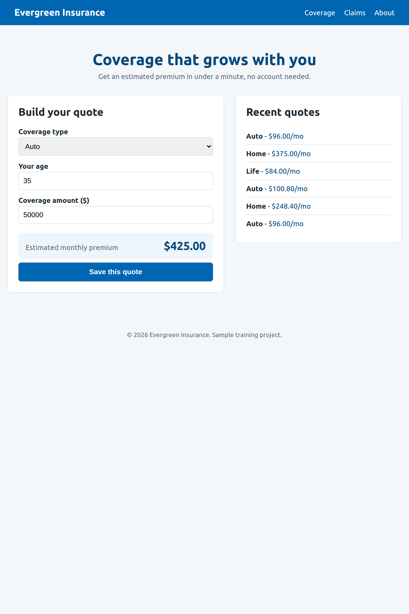
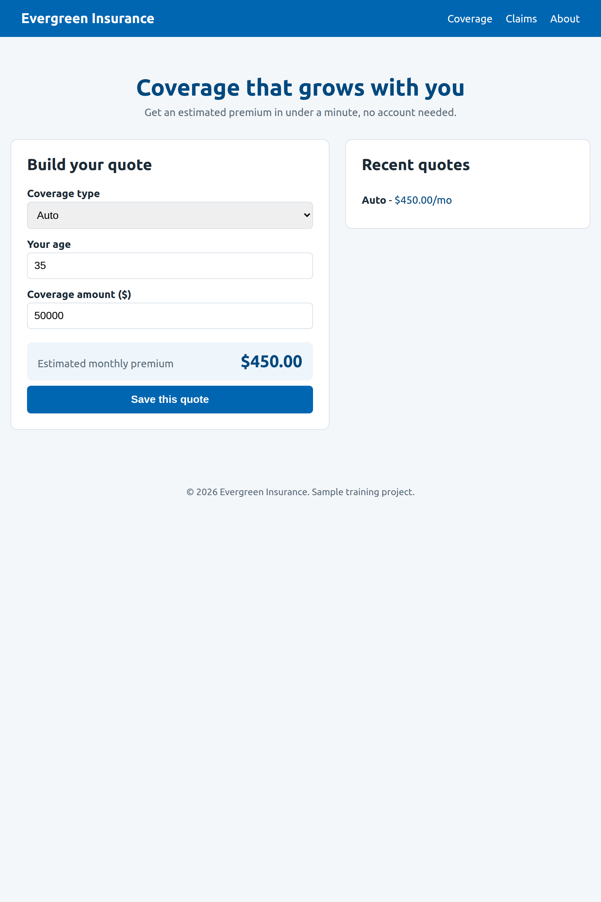

# Program Showcase: Evergreen Quote Launch

**Scott Cannon · Delivery Lead (solo) · Final capstone · 5 minutes, then 3 minutes of questions**

## Slide 1: Did we hit the delivery goal?

> By Thursday 12 November, the wired Evergreen Quote app saves quotes that survive a reload, the containerized API has run as three replicas on the local cluster with the app unchanged, and the launch is merged to main through a reviewed pull request with both CI jobs green.

**Yes.** Every part of that sentence is something you can check:

- **Quotes survive a reload:** the first time in the program that a quote is still there when you come back.
- **Three replicas, app unchanged:** the same app talked to a dev server, a container and a three-pod cluster without a line changing.
- **Merged and green:** [PR #20](https://github.com/asc1-student12/evergreen-quote-launch/pull/20), squash-merged, with [both CI jobs green on the merge commit](https://github.com/asc1-student12/evergreen-quote-launch/actions/runs/44668124363).

## Slide 2: What shipped

**For a shopper:** they can go from the marketing page to a price, save it, and find it still there when they return. The price on screen is the price we keep.

**Behind it:** the marketing page (Phase 1) opens the app (Phase 2), which reads the quote service (Phase 3), packaged as an image and running as three self-healing copies on a local Kubernetes cluster. Every change is checked automatically on both halves before it can merge.

## Slide 3: Two key decisions

**1. One price on screen, with the server as the source of truth.** When the app first met the quote service, the same inputs showed two prices: $425 estimated and $450 saved. Nothing was broken; the two halves had simply never been compared. Following the sponsor's instruction, I aligned the app's rates as configuration, not code. I kept the instant estimate because a shopper decides in seconds, and logged the remaining duplication for the next round. ([decision-memo.md](decision-memo.md))

**2. Go with conditions on Friday's demo, while another team's environment was down.** An incident hit the shared demo environment two days before launch. I checked my own stack and showed it was healthy, routed the fault to the team that owns it, and made the call from the evidence rather than the alarm. ([go-no-go.md](go-no-go.md))

## Slide 4: Risks, and how I handled the injects

**Top risk:** a demo that depends on three running parts at once: the app, the service and the database. Before every demo I check what is actually running. That check caught a leftover process answering in place of the cluster, three times this week. ([risk-register.md](risk-register.md))

**Inject #1, "make it lead with life":** one ask, split into two decisions. The marketing page is content I own, so I approved and changed it. The form's default is one word, but it sits in the engineering team's code two days before launch, so I routed it to them. Renters stays out: it would cross two validation systems. ([status-update.md](status-update.md))

**Inject #2, the shared environment down:** I named the broken environment precisely, asked its owners one specific question with a deadline, and gave the reporting manager a calm holding message. I did not touch their system. ([incident-comms.md](incident-comms.md))

**AI:** Copilot's seed data looked right and was not. It also edited things it was not asked to change. I rejected it, and showed that our automated checks would not have caught a bad row. ([copilot-critique.md](copilot-critique.md))

## Slide 5: The program in one slide, and what I take back to work

- **Phase 1:** a static page that explained the product.
- **Phase 2:** a typed app that estimated a price as you typed.
- **Phase 3:** a service that remembered quotes and ran in containers on a cluster.
- **This week:** all three joined into one product. The marketing page opens the app, the app reads the service, and a saved quote is still there tomorrow.

**The habit I take to Monday:** check what is actually running before trusting what you see. A green screen is a claim; the evidence is what proves it.

## Q&A preparation

- **"Why not just change the one word Marketing asked for?"** Because small to type is not small to ship. It sits in code every estimate flows through, owned by another team, two days before launch.
- **"Why didn't you fix the shared environment?"** It is the platform team's system. My job was to give them the evidence and the right question, and to make sure Friday did not depend on it.
- **"Why is the list empty on the cluster?"** It is a separate database, created inside the cluster. Same product, different data: the code never changed.
- **"Did you use AI?"** Yes, as a coach and for drafts, and Copilot for one step. Every command and every check was mine, and I rejected Copilot's output when it was wrong.
- **"Why no cloud deployment?"** It was optional. I prioritised the required launch, and the demo was designed to run locally.

